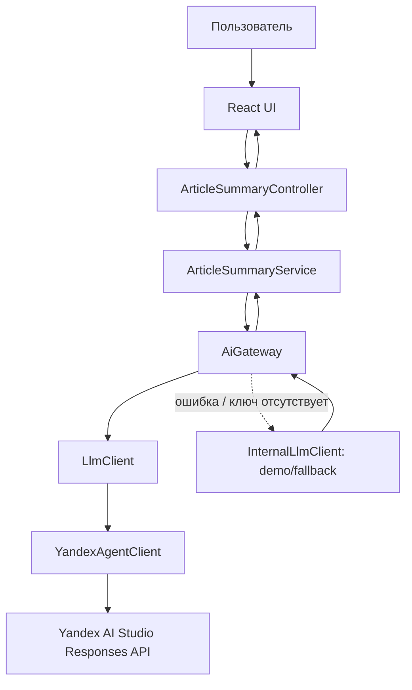

# NewsBrief AI — аннотации новостей (вариант 13)

Веб-приложение для медиаплатформы: превращает текст статьи в краткую аннотацию для новостной ленты. Frontend — React + TypeScript + Vite; backend — Java 21 + Spring Boot. Поддерживается создание текстового агента через Yandex AI Studio Responses API (модель + системная инструкция; также доступен сохранённый prompt-шаблон), а также локальный детерминированный провайдер для демонстрации без API-ключа и как fallback.

## Возможности

- Полноценный адаптивный веб-интерфейс: примеры статей, выбор длины, включение тезисов, состояние backend, просмотр Markdown, копирование и скачивание результата.
- Контракт `POST /api/articles/summarize`, валидация входных данных и нормализованные ошибки.
- Слои `Controller → Service → AiGateway → LlmClient → provider client`.
- `YandexAgentClient` и `InternalLlmClient`; провайдер выбирается через конфигурацию.
- Автоматический fallback на локальный алгоритм при отсутствующих реквизитах или ошибке удалённого провайдера.
- Тайм-ауты, Resilience4j Retry и Circuit Breaker, метрики `ai.gateway.requests`, Spring Actuator/Prometheus.
- Секреты только через переменные окружения; содержимое статей не записывается в логи.
- Docker Compose разделяет API и статический web/nginx контейнер.
- Unit-тесты сервисного слоя и интеграционные тесты REST API.

## Быстрый запуск через Docker

1. Установи Docker Desktop (Windows/macOS) или Docker Engine + Compose.
2. Если нужен Yandex AI, скопируй `.env.example` в `.env` и заполни значения. Без `.env` сайт запустится в demo-режиме.
   - PowerShell: `Copy-Item .env.example .env`
   - Linux/macOS: `cp .env.example .env`
3. Из корня проекта выполни:

   ```bash
   docker compose up --build
   ```

4. Открой:
   - Сайт: http://localhost:8081
   - Backend API: http://localhost:8080
   - Swagger UI: http://localhost:8080/swagger-ui.html
   - Health: http://localhost:8080/actuator/health
   - Состояние режимов: http://localhost:8080/api/system/status
   - Prometheus: http://localhost:8080/actuator/prometheus

Docker запускается и без ключа, используя внутренний демонстрационный алгоритм. Для внешнего Yandex AI Studio добавь параметры в локальный `.env` (создай его на основе `.env.example`):

```dotenv
YANDEX_API_KEY=your_api_key
# Или YANDEX_IAM_TOKEN вместо API-ключа.
YANDEX_FOLDER_ID=your_folder_id
# Необязательно: ID сохранённого prompt-шаблона Responses API.
YANDEX_PROMPT_ID=your_saved_prompt_configuration_id
YANDEX_MODEL=yandexgpt-5-lite
APP_LLM_ACTIVE_PROVIDER=yandex
```

Ключ API передаётся как `Authorization: Api-Key ...`, IAM-токен — как `Authorization: Bearer ...`. Никогда не публикуй `.env` и не вставляй секреты в исходный код. Для внешнего вызова обязательно нужны `YANDEX_FOLDER_ID` и API-ключ или IAM-токен. По умолчанию сервис создаёт текстового агента через Responses API из модели и встроенной инструкции. При наличии сохранённого prompt-шаблона в Yandex AI Studio можно дополнительно указать его ID в `YANDEX_PROMPT_ID`. Это ID prompt-шаблона, а не ID опубликованного канала/виджета Agent Atelier.

Чтобы принудительно использовать только внутренний режим:

```dotenv
APP_LLM_ACTIVE_PROVIDER=internal
```

## Локальная разработка без Docker

Требуются Java 21, Maven 3.9+ и Node.js 22.12+ (или 20.19+) с npm.

Backend (терминал 1):

```bash
# Windows PowerShell: сначала задай переменные окружения при подключении Yandex.
cd .
mvn spring-boot:run
```

Frontend (терминал 2):

```bash
cd frontend
npm install
npm run dev
```

Vite откроется на http://localhost:5173 и проксирует `/api`, `/actuator`, `/swagger-ui*` и `/v3/api-docs` на backend `localhost:8080`.

## API

`POST /api/articles/summarize`

```json
{
  "title": "Заголовок статьи",
  "sourceName": "Название источника",
  "articleText": "Текст новости длиной не менее 40 символов...",
  "length": "short",
  "includeKeyPoints": true
}
```

`length` принимает `short` или `standard`; текст статьи ограничен 25 000 символами. Ответ содержит `summary`, `provider`, `requestId`, `fallbackUsed`, `processingTimeMs`, `outputCharacters`.

- `GET /api/system/status` — безопасный статус конфигурации провайдера.
- `GET /actuator/health` — health-check.
- `GET /actuator/metrics/ai.gateway.requests` — агрегированная метрика запросов AI Gateway.
- `GET /actuator/prometheus` — метрики Prometheus.
- `GET /swagger-ui.html` и `GET /v3/api-docs` — OpenAPI UI и схема.

## Проверки

```bash
mvn test
cd frontend
npm run build
```

Интеграционный тест проверяет REST API в demo-режиме без внешней сети. Реальный вызов Yandex AI Studio не включён в unit-тесты: для его подтверждения нужны действующие реквизиты, доступ/роли AI Studio и корректный ID конфигурации. Одна лишь успешная сборка не является подтверждением реального обращения к внешней LLM.

## Архитектура



Подробные правила для AI-ассистента находятся в [`README-AI.md`](README-AI.md), ADR — в [`docs/adr/0001-yandex-agent-gateway.md`](docs/adr/0001-yandex-agent-gateway.md), отчёт — в [`otchet.md`](otchet.md).
