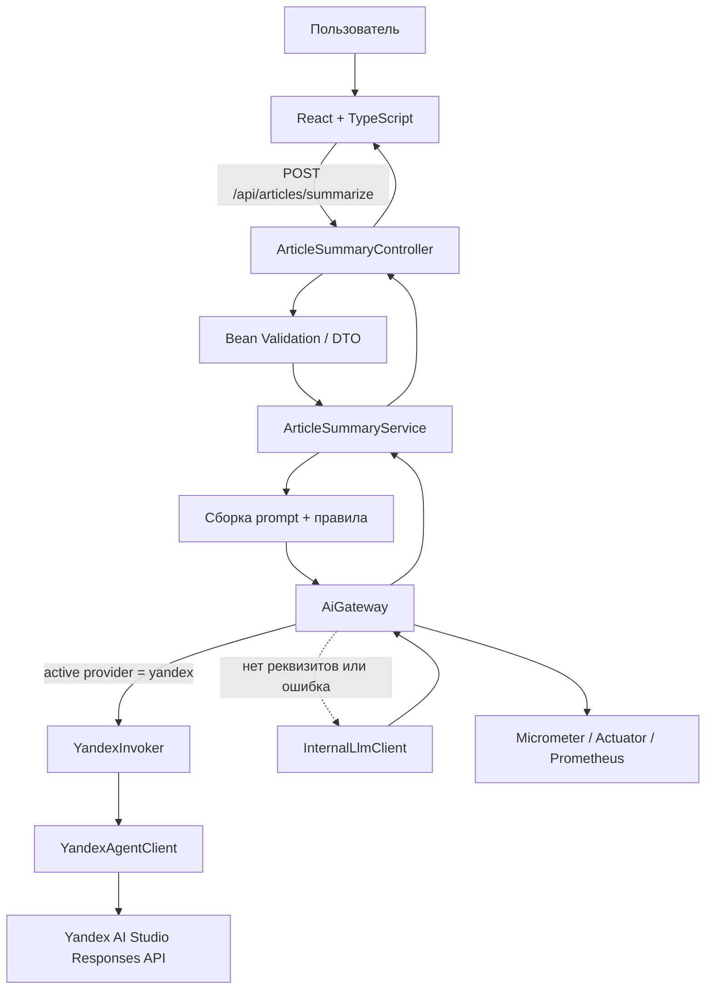

# Отчёт по лабораторной работе № 1

## Проектирование AI-ready архитектуры Spring Boot-сервиса: AI Gateway, абстракция над LLM-провайдерами и подготовка контекста для AI-ассистента

**Предметная область:** медиаплатформа — сервис генерации краткой аннотации статьи для новостной ленты.  
**Вариант:** 13.  
**Проект:** NewsBrief AI.  
**Стек:** Java 21, Spring Boot, React, TypeScript, Vite, Yandex AI Studio Responses API, Resilience4j, Micrometer, Docker Compose.  
**Выполнил:** Фуфаев Никита.  
**Группа:** ____________________.  
**Проверил:** ____________________.  
**Год:** 2026.

> **Примечание о проверке.** Структура и код проекта были переработаны и проверены статически. В среде подготовки отсутствует Maven и Docker CLI; загрузка npm-зависимостей завершилась ошибкой DNS к registry.npmjs.org. Поэтому тесты, production-сборка frontend и контейнерный запуск здесь не были фактически выполнены. В проект добавлены автоматические unit- и интеграционные тесты и CI-сценарий. Реальный вызов Yandex AI Studio также требует действующего ключа/токена и идентификатора конфигурации, которых в исходных файлах нет. Ниже эти ограничения отделены от фактически реализованного кода.

---

## 1. Цель и задачи работы

**Цель:** разработать AI-ready Spring Boot-сервис для генерации коротких аннотаций новостных статей и освоить безопасную интеграцию LLM через AI Gateway, заменяемые провайдеры, context engineering и инженерную оценку AI-сгенерированного решения.

**Задачи:**

1. Проанализировать предметную область варианта 13 и определить контракт входных и выходных данных.
2. Реализовать интерфейс `LlmClient`, внешний Yandex-клиент и внутренний демонстрационный клиент.
3. Реализовать `AiGateway` с выбором провайдера, метриками и резервным переключением.
4. Разделить HTTP, бизнес-логику, DTO, доменные правила, конфигурацию и внешние клиенты.
5. Настроить переменные окружения, тайм-ауты, Retry, Circuit Breaker, логирование и Actuator.
6. Создать React-интерфейс для ручной проверки функциональности и статуса режима работы.
7. Обеспечить контейнерный запуск API и frontend через Docker Compose.
8. Подготовить правила для AI-ассистента, ADR, тесты, сравнение контекста и критический разбор слабого прототипа.
9. Ответить на контрольные вопросы и зафиксировать ограничения текущего прототипа.

## 2. Описание варианта 13

### 2.1. Предметная область и цель сервиса

Медиаплатформе необходимо быстро готовить короткие аннотации материалов для карточек новостной ленты. Редактор вставляет исходную статью, при необходимости указывает заголовок и источник и выбирает формат аннотации. Система возвращает читабельный черновик с основной мыслью и, по выбору, несколькими ключевыми тезисами.

Сервис не должен самостоятельно дополнять исходную статью внешними сведениями или превращать предположение в факт. Аннотация — редакционный черновик, а не замена фактчекинга. Перед публикацией нужно сверить даты, имена, числа и смысл с первоисточником.

### 2.2. Входные и выходные данные

Endpoint: `POST /api/articles/summarize`, JSON.

| Поле | Тип | Обязательность и ограничения |
|---|---|---|
| `title` | string | Необязательно, до 250 символов |
| `sourceName` | string | Необязательно, до 150 символов |
| `articleText` | string | Обязательно, 40–25 000 символов |
| `length` | string | `short` или `standard`; по умолчанию стандартный режим |
| `includeKeyPoints` | boolean | Необязательно; по умолчанию тезисы включены |

Пример запроса:

```json
{
  "title": "Университет представил новый исследовательский проект",
  "sourceName": "Редакция",
  "articleText": "Команда университета представила прототип платформы...",
  "length": "short",
  "includeKeyPoints": true
}
```

Ответ содержит `summary` (Markdown), `provider`, `requestId`, `fallbackUsed`, `processingTimeMs` и `outputCharacters`. Идентификатор запроса нужен для диагностики без записи текста статьи в логи. Поле `fallbackUsed` помогает frontend не выдавать локальный демонстрационный результат за ответ внешней модели.

### 2.3. Контракт ошибок

- `400 Bad Request` — нарушена валидация DTO или передан некорректный JSON.
- `502 Bad Gateway` — невозможно обработать запрос после внутренних ошибок; клиент получает нейтральное сообщение без стека вызовов.
- `GET /api/system/status` — безопасная информация о том, какой провайдер настроен и доступен ли режим Yandex по конфигурации.

## 3. Архитектура и AI Gateway

### 3.1. Диаграмма потока



### 3.2. Разделение пакетов

```text
src/main/java/ru/newsbrief/
├── controller/   # HTTP endpoint и статус приложения
├── service/      # бизнес-правила и подготовка prompt
├── client/       # Yandex API и локальный внутренний клиент
├── dto/          # входной и выходной REST-контракт
├── domain/       # правило выбора длины аннотации
├── config/       # настройки провайдера и HTTP-клиента
├── llm/          # LlmClient, LlmResult, AiGateway, YandexInvoker
├── common/       # общий обработчик API-ошибок
└── NewsBriefApplication.java
```

### 3.3. Назначение компонентов

**Controller.** Привязывает JSON к DTO, запускает Bean Validation и передаёт запрос в сервис. Не формирует prompt, не вызывает `RestClient` и не знает формат API Yandex.

**Service.** Нормализует необязательные поля, определяет длину ответа, формирует prompt с границами `<<<ARTICLE>>>` / `<<<END ARTICLE>>>`, передаёт запрос в Gateway и создаёт DTO результата.

**LlmClient.** Провайдеронезависимый контракт. Возвращает `LlmResult`, содержащий текст, метку провайдера и флаг fallback.

**YandexAgentClient.** Адаптер к `POST https://ai.api.cloud.yandex.net/v1/responses`. По умолчанию формирует запрос текстового агента через Responses API с моделью `gpt://{folder-id}/{model}` и системной инструкцией; при наличии сохранённого prompt-шаблона использует его ID из `YANDEX_PROMPT_ID`. Это ID prompt-шаблона, а не опубликованного канала/виджета Agent Atelier. Поддерживает API-ключ (`Authorization: Api-Key ...`) и IAM-токен (`Authorization: Bearer ...`). Обрабатывает текстовый ответ API и не пишет содержимое статьи в лог.

**InternalLlmClient.** Детерминированный offline-клиент, который выделяет предложения из исходного текста. Он нужен для демонстрации без внешних реквизитов и для аварийного ответа. Это не языковая модель и не production-эквивалент Yandex AI: результат помечается как demo/fallback.

**AiGateway.** Единственная точка маршрутизации. Выбирает `yandex` или `internal` по `APP_LLM_ACTIVE_PROVIDER`; если удалённые реквизиты отсутствуют или запрос завершился ошибкой, использует internal-клиент. Записывает счётчики по провайдеру и статусу.

**YandexInvoker.** Граница устойчивости удалённого вызова. На неё применены Resilience4j Retry и Circuit Breaker, чтобы повторять ограниченный набор временных ошибок и прекращать заведомо бесполезные вызовы при частых сбоях.

**Конфигурация.** `application.yml` содержит только имена переменных окружения и безопасные defaults. Секретов в конфигурации и frontend нет.

### 3.4. Ключевые решения

1. **Gateway вместо вызова модели из Service.** Сервис зависит от стабильного контракта, а не от протокола конкретного поставщика.
2. **Внешний и внутренний провайдеры.** Приложение можно проверить без ключа, но UI и API явно сообщают о demo-режиме.
3. **Fallback не маскируется под LLM.** В ответ включены provider и `fallbackUsed`; UI отображает предупреждение.
4. **Запросы не логируются целиком.** В лог попадают ID, провайдер, длительность и размеры текста, но не текст статьи, prompt, ответ и секреты.
5. **Без web search по умолчанию.** Аннотация должна пересказывать предоставленный материал, а не дополнять его непроверенными внешними фактами.
6. **Контейнеры разделены.** API и nginx/frontend запускаются как отдельные Docker Compose services. Это надёжнее, чем запускать Java и nginx в одном контейнере без полноценного process supervisor.

## 4. Реализация ключевых классов

Ниже приведены сокращённые листинги. Актуальная полная реализация находится в `src/main/java/ru/newsbrief`.

### 4.1. Интерфейс LlmClient и результат

```java
public interface LlmClient {
    String providerName();
    LlmResult generate(String input);
}

public record LlmResult(String text, String provider, boolean fallbackUsed) {
    public LlmResult {
        if (text == null) text = "";
        if (provider == null || provider.isBlank()) provider = "unknown";
    }
}
```

Контракт не зависит от REST API конкретной модели. Метаданные необходимы для диагностики и корректной маркировки резервного режима в пользовательском интерфейсе.

### 4.2. AiGateway

```java
public LlmResult generateSummary(String prompt) {
    String selected = llmProperties.normalizedProvider();
    if ("internal".equals(selected)) {
        return tracked(internalClient.generate(prompt), "internal", "success");
    }
    if (!"yandex".equals(selected)) {
        throw new IllegalStateException("Unsupported active provider");
    }
    if (!yandexProperties.isReady()) {
        String reason = yandexProperties.hasCredentials()
                ? "configuration_incomplete" : "credentials_missing";
        return fallback(prompt, reason);
    }
    try {
        return tracked(yandexInvoker.generate(prompt), "yandex", "success");
    } catch (Exception ex) {
        log.warn("Yandex provider failed ({}); switching to internal provider",
                 ex.getClass().getSimpleName());
        return fallback(prompt, "provider_error");
    }
}
```

Фрагмент показывает политику маршрутизации. В полной версии есть Micrometer-счётчики, безопасное логирование и отдельный метод формирования fallback-результата. Исключение не содержит текста статьи и не передаётся frontend.

### 4.3. Service и построение контекста

```java
SummaryLength summaryLength = SummaryLength.from(request.length());
String prompt = "РОЛЬ: Ты — редактор новостной медиаплатформы.\n" +
    "ЗАДАЧА: Сформируй аннотацию строго на основе исходного материала.\n" +
    "ПРАВИЛА: нейтральный тон; не добавляй факты и домыслы; " +
    "сохрани имена, даты и числа.\n" +
    "ЗАГОЛОВОК: " + title + "\n" +
    "ИСТОЧНИК: " + source + "\n" +
    "ЖЕЛАЕМАЯ ДЛИНА: " + summaryLength.promptLabel() + "\n" +
    "ТЕКСТ СТАТЬИ:\n<<<ARTICLE>>>\n" + article + "\n<<<END ARTICLE>>>";
LlmResult result = gateway.generateSummary(prompt);
```

Контекст включает задачу, предметную область, формат, длину, метаданные статьи и чёткие границы её содержимого. Важное ограничение: текст статьи считается недоверенными данными; он не должен трактоваться как системная инструкция, и приложение не должно выполнять команды, которые могут находиться внутри материала.

### 4.4. Controller и DTO

```java
@RestController
@RequestMapping("/api/articles")
public class ArticleSummaryController {
    private final ArticleSummaryService service;

    @PostMapping("/summarize")
    public ResponseEntity<SummaryResponse> summarize(
            @Valid @RequestBody SummaryRequest request) {
        return ResponseEntity.ok(service.summarize(request));
    }
}
```

DTO ограничивает длину полей до обработки запроса. Controller вызывает только сервисный слой. REST-контракт открыт через Swagger UI.

### 4.5. Конфигурация

Пример безопасной конфигурации:

```yaml
app:
  llm:
    active-provider: ${APP_LLM_ACTIVE_PROVIDER:yandex}
  yandex:
    base-url: ${YANDEX_BASE_URL:https://ai.api.cloud.yandex.net/v1}
    api-key: ${YANDEX_API_KEY:}
    iam-token: ${YANDEX_IAM_TOKEN:}
    folder-id: ${YANDEX_FOLDER_ID:}
    model: ${YANDEX_MODEL:yandexgpt-5-lite}
    prompt-id: ${YANDEX_PROMPT_ID:}
    connect-timeout-seconds: ${YANDEX_CONNECT_TIMEOUT_SECONDS:5}
    read-timeout-seconds: ${YANDEX_READ_TIMEOUT_SECONDS:45}
```

`.env` игнорируется Git. В `.env.example` перечислены только пустые или безопасные значения. API-ключ хранится только в локальной конфигурации запуска, на backend. Переменная `VITE_` не используется для секрета, поскольку Vite раскрывает такие значения в браузерном bundle.

### 4.6. Обработка ошибок и наблюдаемость

`ApiExceptionHandler` единообразно обрабатывает валидацию и некорректный JSON. Неожиданная ошибка приводит к нейтральному сообщению и HTTP 502; стек вызовов и тело исключения внешнего API не раскрываются. Actuator публикует health, metrics и Prometheus. Счётчик `ai.gateway.requests` имеет теги провайдера и статуса. Содержимое статьи не логируется; вместо этого записываются request ID, длина входа/выхода и длительность операции.

## 5. Frontend и Docker

### 5.1. Функциональность веб-интерфейса

Frontend NewsBrief AI сделан на React + TypeScript и включает:

- поля заголовка и источника, выбор длины аннотации и переключатель ключевых тезисов;
- три примерных материала для проверки без подготовки собственного текста;
- счётчик символов и клиентскую предварительную проверку минимальной длины;
- отображение процесса генерации, ошибок и результата Markdown;
- provider/fallback метки, длительность, длину ответа и request ID;
- копирование и скачивание `.md`;
- статус настроенного AI-режима и ссылку на Swagger UI;
- адаптивную тёмную визуальную тему и предупреждение о редакторской проверке.

UI не обращается к Yandex напрямую. Все вызовы идут через `/api`, поэтому секреты остаются на серверной стороне.

### 5.2. Docker Compose

Проект состоит из двух сервисов:

- `api` — Java 21 runtime, порт `8080`;
- `web` — Nginx со статическим React build, порт `8081`; Nginx проксирует `/api`, `/actuator`, Swagger и OpenAPI к `api:8080`.

Запуск из корня проекта:

```bash
docker compose up --build
```

Адреса:

- сайт: `http://localhost:8081`;
- API: `http://localhost:8080`;
- Swagger: `http://localhost:8080/swagger-ui.html`;
- статус: `http://localhost:8080/api/system/status`;
- health: `http://localhost:8080/actuator/health`;
- Prometheus: `http://localhost:8080/actuator/prometheus`.

Ключ Яндекса не обязателен для старта: в отсутствии реквизитов Gateway сообщает о fallback и использует внутренний демонстрационный алгоритм. Для реального вызова нужны правильные `YANDEX_API_KEY` или `YANDEX_IAM_TOKEN` и `YANDEX_FOLDER_ID`; если используется сохранённый prompt-шаблон, дополнительно задаётся его `YANDEX_PROMPT_ID`, иначе выбираются модель и встроенная инструкция. Работоспособность реального агентского вызова зависит от прав доступа и конфигурации в Yandex AI Studio.

## 6. README-AI.md и инженерные правила

Файл `README-AI.md` фиксирует конкретные ограничения AI-assisted разработки:

**Разрешено:** создавать DTO в `dto`, бизнес-логику в `service`, провайдеры через `LlmClient`, тесты JUnit/Mockito, интеграционные тесты MockMvc, метрики без чувствительного содержимого, обновлять API-документацию и frontend при изменении контракта.

**Запрещено:** хранить секреты в репозитории; вызывать внешние API из контроллеров; логировать статью или ответы модели; выдавать локальный fallback за LLM; подменять неподтверждённые данные фактами; отключать валидацию, тесты или защитные механизмы ради сборки; раскрывать клиенту stack trace; менять REST API без обновления DTO, тестов, Swagger и README.

Такое описание правил позволяет AI-инструментам ориентироваться не только на цель задачи, но и на границы компонентов, контракты и ограничения безопасности.

## 7. Сравнение результата при разном контексте

### 7.1. Задача для сравнения

**Одинаковая базовая задача:** «Создай сервис, который принимает текст новостной статьи и возвращает краткую аннотацию для ленты».

Для сопоставимости модели должны работать с одним и тем же исходным материалом. Различаться будет только объём инженерного контекста.

### 7.2. Режим A — только задача

**Промпт A:**

> Создай сервис, который принимает текст новостной статьи и возвращает краткую аннотацию для ленты. Предложи архитектуру и пример кода.

**Иллюстративный ответ A (не результат живого вызова Yandex AI Studio):**

> Можно сделать REST-контроллер с методом `POST /summary`, который принимает текст статьи. Контроллер отправляет текст в LLM API, получает ответ и возвращает его клиенту. Для prompt достаточно инструкции: «Суммируй эту статью в 3 предложениях». В конфигурации следует указать API-ключ. Затем нужно создать React-форму с текстовым полем и кнопкой отправки.

**Анализ:** ответ даёт направление, но оставляет существенные решения незафиксированными: нет разделения API от бизнес-слоя, абстракции провайдера, альтернативного клиента, определения длины/формата, обработки отказов, тайм-аутов, тестов, метрик и правил хранения ключей. В наиболее простой реализации возникает риск вызова LLM из контроллера и прямой связи приложения с одним API.

### 7.3. Режим B — задача + проектный контекст

**Промпт B:**

> Создай сервис генерации аннотаций новостных статей для проекта NewsBrief AI. Стек: Java 21, Spring Boot, React/TypeScript. Пакеты: `controller`, `service`, `client`, `dto`, `domain`, `config`, `llm`. REST-контракт: `POST /api/articles/summarize`; `articleText` обязателен (40–25 000 символов), `title` до 250 символов, `sourceName` до 150, `length` — `short` или `standard`, `includeKeyPoints` — boolean. Ответ: `summary`, `provider`, `requestId`, `fallbackUsed`, `processingTimeMs`, `outputCharacters`. Controller может только вызвать Service. Бизнес-логика и построение prompt находятся в Service. Вызов модели идёт только через `AiGateway` и интерфейс `LlmClient`. Нужны Yandex AI Studio Responses API и внутренний локальный клиент, выбор провайдера через env config, timeouts, ограниченный Retry, Circuit Breaker, fallback, Micrometer, логирование без содержимого статьи/секретов, unit-тесты service-layer, интеграционные тесты MockMvc, Docker Compose с раздельными API и frontend. Секреты нельзя хранить в репозитории; локальный demo-режим не должен выдаваться за реальный вызов LLM. Аннотация не должна придумывать факты. Предложи архитектуру и ключевые решения.

**Иллюстративный ответ B (не результат живого вызова Yandex AI Studio):**

> Следует реализовать `ArticleSummaryController → ArticleSummaryService → AiGateway → LlmClient`. `YandexAgentClient` работает с Responses API, `InternalLlmClient` предоставляет детерминированный offline-режим. Gateway выбирает клиент из конфигурации и при недоступности Yandex использует fallback, указывая provider и флаг fallback в ответе. Секреты передаются через окружение, HTTP-запросы имеют тайм-ауты, вызов Yandex защищён Retry и Circuit Breaker. Service формирует prompt с чёткими границами исходной статьи, а результат сопровождается request ID и метаданными. Контроллер проверяет DTO и не знает о конкретном LLM API. Нужны unit- и integration-тесты, Actuator/Prometheus и отдельные Docker services для API и UI.

**Анализ:** второй ответ точнее отражает требования, поскольку в контекст были переданы API-контракт, слои, варианты отказа, security-ограничения, требования к тестам и запуску. Модель меньше оставляет архитектурных решений «на потом» и имеет более узкое пространство допустимых реализаций. При этом подробный контекст не гарантирует правильности кода: сгенерированный ответ всё равно необходимо сопоставить с документацией API, скомпилировать и проверить тестами.

### 7.4. Сводное сравнение

| Критерий | Только задача | Расширенный контекст |
|---|---|---|
| API-контракт | Обобщённый `/summary` | Конкретный путь и DTO |
| Границы слоёв | Могут отсутствовать | Controller → Service → Gateway → Client |
| Провайдеры | Обычно один | Yandex + Internal, выбор из конфигурации |
| Секреты | Риск встроенного ключа | Окружение, запрет на frontend и репозиторий |
| Ошибки | Неопределённо | Timeouts, Retry, Circuit Breaker, fallback |
| Наблюдаемость | Не упомянута | Метрики, request ID, безопасные логи |
| Проверки | Редко определены | Unit- и интеграционные тесты |
| Достоверность | Общий prompt | Явный запрет на новые факты и обязательная редакторская проверка |

**Ограничение эксперимента:** ответы выше — контрольные иллюстрации для анализа разницы контекста. В среде подготовки не было действующих credentials для повторного вызова Yandex AI Studio, поэтому их нельзя выдавать за дословные ответы, фактически сохранённые из внешнего сервиса. Для полного экспериментального подтверждения следует отправить оба промпта в один и тот же выбранный провайдер, записать ответы, дату, модель/agent ID и сравнить их по одинаковой шкале.

## 8. Разбор слабого AI-прототипа и инженерные исправления

### 8.1. Пример слабого решения

```java
@RestController
class SummaryController {
    @Value("${yandex.api.key}")
    private String apiKey;

    @PostMapping("/summary")
    String summarize(@RequestBody Map<String, String> body) {
        RestClient client = RestClient.create();
        String text = body.get("articleText");
        Map<String, Object> payload = Map.of(
            "input", "Суммируй статью: " + text,
            "apiKey", apiKey
        );
        return client.post().uri("https://example.invalid/v1/responses")
            .body(payload).retrieve().body(String.class);
    }
}
```

Это намеренно упрощённый учебный пример, а не код текущего проекта и не утверждение о реальном endpoint. Он показывает распространённый прототипный подход — собрать всё в контроллере.

### 8.2. Выявленные проблемы и исправления

1. **Смешение слоёв:** контроллер занимается HTTP, prompt, сетью и обработкой результата. Исправление — вынести правила в `ArticleSummaryService`, а провайдера в `client`.
2. **Прямой вызов LLM из Controller:** контроллер связан с API-поставщиком. Исправление — `AiGateway` и `LlmClient`.
3. **Секрет используется в неправильной границе:** контроллер получает credential и передаёт его дальше. Исправление — секрет применяется только server-side в Yandex-клиенте и передаётся из переменных окружения.
4. **Нет валидации DTO:** `Map<String,String>` не ограничивает длину/обязательность. Исправление — `SummaryRequest` с Bean Validation.
5. **Нет тайм-аутов и отказоустойчивости:** HTTP-вызов может долго зависать. Исправление — connect/read timeout, Retry для ограниченного набора временных ошибок, Circuit Breaker и fallback.
6. **Нет обработки/оценки результата:** пустой или нерелевантный ответ может быть принят. Исправление — проверка пустого ответа, возврат метаданных, явная пометка demo/fallback и фактчекинг редактором.
7. **Нет observability:** невозможно связать запрос с ошибкой и оценить частоту отказов. Исправление — request ID, Micrometer counters, Actuator и Prometheus.
8. **Нет тестов и контракта:** изменения могут ломать API незаметно. Исправление — тесты сервиса с mock Gateway, интеграционные проверки MockMvc, Swagger и CI.
9. **Нет защиты от prompt injection:** текст статьи может содержать императивные фразы. Исправление — рассматривать содержание как данные, ограничивать задачу системными инструкциями, не давать модели инструменты/действия, не нужные для суммаризации.
10. **Нет честного разделения реального AI и заглушки:** демо могло бы выглядеть как полноценная модель. Исправление — `provider`, `fallbackUsed` и явное предупреждение UI.

### 8.3. Production-риски

- **Vendor lock:** изменение API/цены/доступности Yandex потребует адаптации. Контракт `LlmClient` уменьшает стоимость замены, но не устраняет все различия между моделями.
- **Стоимость и квоты:** длинные статьи и повторные запросы повышают расход. Нужны лимиты, rate limiting и budget alerts.
- **Безопасность и данные:** текст статьи может содержать персональные сведения или закрытую информацию. Необходимо определить политику передачи внешнему поставщику, права доступа и ретенцию данных.
- **Фактические ошибки и сокращение нюансов:** модель может изменить степень уверенности, пропустить атрибуцию или исказить число. Нужна редакторская проверка.
- **Prompt injection:** инструкции внутри статьи могут попытаться изменить поведение модели. Вход нужно трактовать только как цитируемый источник, а не как системную инструкцию.
- **Отказ провайдера:** Retry не устраняет постоянную недоступность, а fallback-алгоритм упрощён. Для production нужны алерты, SLA и политика отказа.
- **Недостаточная защита endpoint:** в учебном приложении не реализованы пользовательская аутентификация и rate limits. Перед публичным развёртыванием их нужно добавить.

### 8.4. Архитектурное правило против повторения

> Вызов внешней LLM разрешён только в классе реализации `LlmClient` из пакета `client`. Controller и Service не создают HTTP-клиенты и не знают заголовков/форматов провайдера. Все запросы проходят через `AiGateway`. Любой demo/fallback-результат обязан маркироваться в API и UI. Для каждой новой ветки поведения добавляется тест.

## 9. Тестирование и состояние проверки

### 9.1. Подготовленные тесты

В проект добавлены 13 тестовых сценариев:

- `ArticleSummaryServiceTest` — передача контекстного prompt, обработка опции тезисов, реакция на пустой ответ;
- `InternalLlmClientTest` — локальная генерация по маркерам статьи и соблюдение отключения тезисов;
- `AiGatewayTest` — выбор внутреннего клиента по конфигурации и fallback после ошибки Yandex;
- `YandexAgentClientTest` — формат запроса Responses API, схема авторизации, сохранённый prompt и отказ без credentials;
- `ArticleSummaryIntegrationTest` — вызов REST endpoint в demo-режиме, отклонение слишком короткой статьи, доступность status endpoint.

### 9.2. Что выполнено фактически

| Проверка | Состояние | Комментарий |
|---|---|---|
| Статический анализ структуры проекта | Выполнен вручную | Проверены файлы, слои, конфигурация и контракты |
| Тесты Maven | Не выполнены в среде подготовки | Maven CLI отсутствует, DNS до Maven Central недоступен |
| Frontend build | Не подтверждён | npm install не смог получить зависимости из-за DNS к npm registry |
| Docker build / Compose up | Не выполнены | Docker CLI отсутствует в среде подготовки |
| Реальный вызов Yandex AI Studio | Не выполнен | Нужны credentials и доступ к конфигурации/модели |
| CI workflow | Добавлен/сохранён | GitHub Actions должен выполнить `mvn -B test` и `npm run build` после push |

Таблица намеренно не содержит выдуманных «зелёных» результатов. Для завершения проверки на рабочем компьютере выполнить команды из README. При проблеме внешнего Yandex вызова нужно проверить credential type (API-key или IAM), folder ID, ID сохранённого prompt, назначенные роли и доступность Responses API.

### 9.3. План ручной проверки

1. Выполнить `docker compose up --build` без `.env`; сайт должен открываться и выдавать внутренний demo/fallback результат.
2. Перейти на `http://localhost:8080/api/system/status` и убедиться, что `effectiveMode=demo` при отсутствии реквизитов.
3. В UI загрузить пример статьи, сгенерировать аннотацию, скопировать и скачать Markdown.
4. Проверить валидацию короткого ввода, предупреждение fallback, `requestId` и время обработки.
5. Настроить credentials Yandex AI Studio, перезапустить Compose и проверить `effectiveMode=yandex`.
6. Проверить `/actuator/health`, `/actuator/metrics/ai.gateway.requests`, `/actuator/prometheus` и Swagger.
7. Выполнить `mvn test`, `npm run build`; сохранить фактический вывод в приложение к отчёту.

## 10. Выводы

Для варианта 13 разработан проект NewsBrief AI с REST API для генерации краткой аннотации новостной статьи. В отличие от простого примера «вызвать LLM из контроллера», решение разделяет HTTP, бизнес-правила, DTO, доменную политику и интеграцию. AI Gateway изолирует код сервиса от конкретного API и выбирает провайдера из конфигурации. Yandex AI Studio поддерживается через Responses API, а внутренний клиент позволяет проверить интерфейс без ключа и обеспечивает резервный сценарий.

Важным инженерным решением стало прозрачное отображение резервного режима: локальный эвристический алгоритм не выдаётся за полноценную LLM. Также предусмотрены валидация, тайм-ауты, Retry, Circuit Breaker, метрики, безопасное логирование, правила AI-assisted разработки, тесты, Docker Compose, Swagger и адаптивный web frontend.

Ограничения: реальный вызов Yandex и запуск тестов не были подтверждены в среде подготовки из-за отсутствия credentials, Maven/Docker CLI и сетевой доступности npm/Maven registry. Кроме того, внутренний алгоритм является демонстрационным, не заменяет языковую модель, не гарантирует редакционное качество и не должен использоваться для автоматической публикации. Для production дополнительно потребуются аутентификация, rate limits, бюджетные ограничения, политика обработки персональных данных, более строгая оценка фактической точности и мониторинг.

Самостоятельная инженерная оценка важнее факта генерации кода: внешний API необходимо сверять с актуальной документацией, архитектурные ограничения — проверять тестами, а полученные аннотации — сопоставлять с исходником.

## 11. Ответы на контрольные вопросы

### 1. Почему использование AI-инструментов само по себе не делает разработку инженерной?

Потому что модель может быстро создать работающий, но непроверенный код. Инженерия включает формализацию требований, контракты, разделение ответственности, обработку отказов, тестирование, observability, безопасность и сопровождение. В NewsBrief AI генерация кода не заменяет проверку DTO, реального формата Responses API, тестов и способа хранения credentials.

### 2. В чём разница между быстрым AI-прототипом и production-ready решением?

Прототип демонстрирует идею, но часто не учитывает сбои внешнего API, нагрузки, утечки данных и тестируемость. Production-ready Java/Spring Boot-сервис нуждается в тайм-аутах, контролируемых повторных попытках, fallback, метриках, логировании без секретов, стабильном контракте, unit/integration-тестах, контейнерном развёртывании и мониторинге. В этом проекте реальный production ещё не достигнут: отсутствует auth/rate limiting и не подтверждён внешний интеграционный запуск.

### 3. Почему ИИ повышает требования к фундаментальным знаниям Java, Spring Boot и архитектуры?

Разработчик должен заметить, что `Controller` не должен создавать HTTP-клиент, что конфигурация должна связываться через Spring, что DTO должны валидироваться, а сетевой сбой — обрабатываться контролируемо. Без понимания DI, AOP, Bean Validation, исключений, тестов и API-контрактов трудно отличить корректную генерацию от кода, который только выглядит правдоподобно.

### 4. Что такое контекст в enterprise-разработке? Приведите не менее семи источников контекста.

Контекст — информация, помогающая правильно принять техническое решение. Источники: требования продукта; исходный код и пакеты; API/OpenAPI-контракт; доменная модель; архитектурные решения/ADR; стандарты кода и `README-AI.md`; тесты; схема БД/миграции; политика безопасности; конфигурация окружения; сведения о наблюдаемости и инцидентах; ограничения инфраструктуры. NewsBrief AI использует DTO, prompt-правила, README-AI, настройки LLM, ADR и тесты как контекст.

### 5. Почему противоречивая документация опасна для RAG и AI-ассистентов?

RAG или агент может извлечь оба противоречащих фрагмента и смешать их. Например, старый README может требовать endpoint `/api/interviews/generate`, а актуальный — `/api/articles/summarize`. Тогда модель может генерировать несовместимый frontend/backend. Нужны единый источник истины, дата актуальности, удаление устаревшей документации и тесты контракта.

### 6. Что такое AI Gateway и какие задачи он решает?

AI Gateway — единая точка доступа к провайдерам моделей. Он выбирает клиент, централизует fallback, метрики, политики ошибок и взаимодействие бизнес-сервиса с LLM. В NewsBrief AI сервис вызывает только `AiGateway`, который маршрутизирует запрос в Yandex или internal client.

### 7. Как AI Gateway помогает избежать vendor lock на LLM?

Бизнес-логика зависит от собственного интерфейса, а не от SDK/формата конкретного поставщика. Новый провайдер реализует `LlmClient` и регистрируется в Gateway. При этом могут различаться prompt, модели, лимиты и формат ответов, поэтому заменяемость не абсолютна: адаптеры и тесты всё равно необходимы.

### 8. Какие правила можно задать AI-ассистенту в Java/Spring Boot-проекте?

Разрешено: создавать DTO в выделенном пакете, размещать бизнес-логику в сервисе, вызывать внешние API через `client`, добавлять unit-тесты и обновлять OpenAPI. Запрещено: хранить API-ключи в репозитории; вызывать внешние API из Controller; логировать статьи и ответы; убирать тесты; изменять публичный контракт без документации. Эти правила закреплены в `README-AI.md`.

### 9. Почему архитектура становится «системой правил для AI-инструментов»?

Потому что AI-агент генерирует изменения в пределах доступного контекста. Если границы и соглашения не записаны, он может смешивать слои, обходить тесты или использовать небезопасную конфигурацию. Архитектура плюс README-AI, ADR, проверки и CI помогают ограничить допустимые изменения.

### 10. Как меняется роль архитектора в эпоху ИИ?

Архитектор тратит меньше времени на механическое написание типового кода и больше — на постановку задачи, контракты, границы модулей, ограничения, проверку рисков и оценку результата. Он должен объяснять компромиссы, выбирать, что автоматизировать, и нести ответственность за соответствие результата потребностям и правилам.

### 11. Что такое context engineering и чем оно отличается от prompt engineering?

Prompt engineering — формулировка конкретной инструкции модели. Context engineering шире: подбор и структурирование требований, доменных знаний, API, архитектурных правил, примеров, тестов и политик. В этой работе одного «суммируй текст» недостаточно; контекст также определяет длину аннотации, запрет новых фактов, маркеры исходника, желаемую структуру и fallback-поведение.

### 12. Какие риски возникают при прямом вызове LLM из бизнес-логики или Controller?

Появляется связь с форматом одного API, дублируются политики ошибок и авторизации, сложно мокировать сеть, а изменения модели влияют на контроллер. Становится труднее централизовать лимиты, метрики и переключение провайдера. В проекте эти обязанности отделены между Service, Gateway и клиентским адаптером.

### 13. Как технический долг может накапливаться быстрее при использовании AI?

Модель быстро добавляет функции, но без тестов и review может множить дублирование, небезопасные defaults и недокументированные контракты. Исправление симптомов генерации одного модуля способно ломать другие. Поэтому важны маленькие изменения, автоматические проверки, архитектурные правила, читаемые PR и актуальная документация.

### 14. Что остаётся человеку в AI-assisted SDLC? Приведите не менее пяти пунктов.

Человек определяет цель и критерии успеха; понимает предметную область; формулирует архитектурные ограничения; принимает решения о рисках, затратах и приватности; проверяет факты и корректность; тестирует интеграции; ревьюит код и отвечает за эксплуатационные последствия. В NewsBrief AI человек остаётся ответственным редактором, который сверяет аннотацию с источником.

### 15. Как оценить AI-сгенерированное решение, если модель выдала рабочий, но архитектурно слабый код?

Работоспособность — лишь один критерий. Нужно проверить слои, стабильность API, обработку ошибок, безопасность секретов, заменяемость провайдера, тестируемость, метрики, качество результата и стоимость сопровождения. Затем перечислить недостатки, добавить тесты/ограничения и сопоставить исправление с критериями задания. В этом проекте показано, почему тонкого Gateway без выбора провайдера и fallback недостаточно.

## 12. Использованные источники

1. Методические указания «Лабораторная работа № 1. Проектирование AI-ready архитектуры Spring Boot-сервиса: AI Gateway, абстракция над LLM-провайдерами и подготовка контекста для AI-ассистента», предоставленный документ, вариант 13 и критерии оценки.
2. Yandex AI Studio. «Аутентификация в API Yandex AI Studio». https://aistudio.yandex.ru/ru/docs/ai-studio/api-ref/authentication (дата обращения: 27.10.2026).
3. Yandex AI Studio. «Create a request / Responses API». https://aistudio.yandex.ru/ru/docs/ai-studio/api/Responses/createResponse (дата обращения: 27.10.2026).
4. Yandex AI Studio. «Текстовые агенты и Responses API». https://aistudio.yandex.ru/ru/docs/ai-studio/concepts/agents/text-agents (дата обращения: 27.10.2026).
5. Spring Boot Reference Documentation. https://docs.spring.io/spring-boot/ (дата обращения: 27.10.2026).
6. Resilience4j Documentation. https://resilience4j.readme.io/ (дата обращения: 27.10.2026).
7. Micrometer Documentation. https://micrometer.io/docs (дата обращения: 27.10.2026).
8. Docker Compose Documentation. https://docs.docker.com/compose/ (дата обращения: 27.10.2026).
